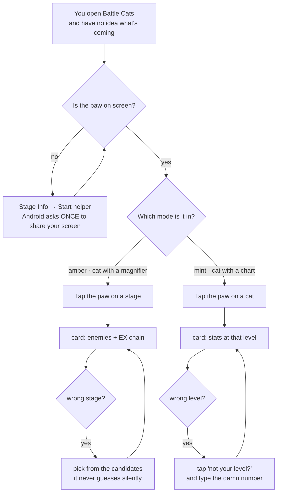
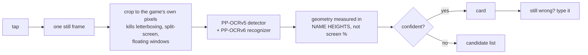
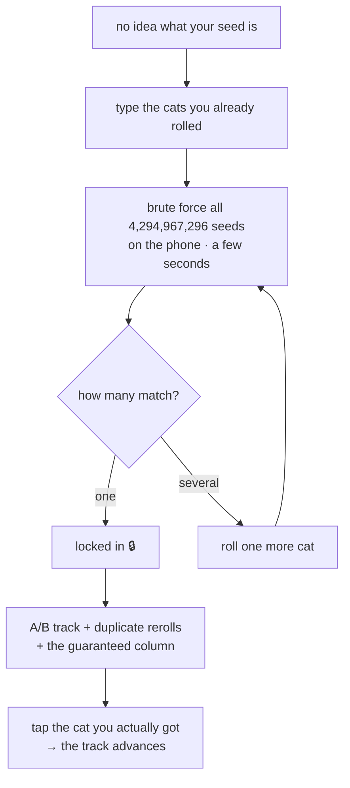

<div align="center">

# 🐱 Nyanko

**A Battle Cats companion that does all its thinking on your phone.**

No account. No queue. No "please wait while we look that up for you."

<br/>


[](https://github.com/Kyokkei/the-battle-cat-companion/releases)


</div>

---

## 📦 Download

Grab the latest ready-to-use APK from the **[Releases](https://github.com/Kyokkei/the-battle-cat-companion/releases)** tab:

| File | Size | Who it's for |
|:--|:--|:--|
| **`Nyanko-arm64-v8a.apk`** | ~78 MB | **99% of modern Android phones. Take this one.** |
| `Nyanko-universal.apk` | ~179 MB | PC emulators (LDPlayer, BlueStacks) and anything that isn't arm64 |
| `Nyanko-full-universal.apk` | ~240 MB | Everything, including the Japanese OCR models. For poking at the JP path — JP stage names still don't work, so this isn't a "JP build" yet |

Why three: ONNX Runtime ships a separate native library per CPU, and 62 MB of the bundle is Japanese OCR models that an English player never loads. So the default download drops both, and you get 78 MB instead of 240.

No Play Store, no account, no "install our launcher first". Sideload it and go.

---

## So what is this thing?

Three things, all of which happen **on the device**, none of which need a server:

| | Tab | What it does | Why you'd care |
|:--:|:--|:--|:--|
| 🐱 | **Stage Info** | Spawn a floating paw. Tap it on the game screen and it reads the stage, lists every enemy that will show up, and chains the hidden EX stages that come after it. | Stop alt-tabbing to a wiki mid-run. |
| 🎯 | **Trackseeding** | Type the cats you already rolled → it brute-forces all **4,294,967,296** possible seeds on your phone in a few seconds and hands you the A/B track. | Know what you're pulling before you spend catfood. |
| 📅 | **Event** | Gacha banners (with art), special events, and *what's open right now* — computed from your own clock. | "Is the XP stage up or do I go to bed?" |

The paw also has a second mode: point it at a cat and it reads **that cat's name and level**, then shows health / damage / DPS at that level. Hold the paw to switch modes.

---

## 🫧 The bubble (the main character)



The rules, in human:

- **One approval per session.** Android's screen-share prompt appears once. The paw never asks again.
- **One frame per tap.** It is not recording you. It grabs a single still, reads it, throws it away.
- **Hold to switch modes** (~half a second). The icon *and* the colour change, so you can tell which mode you're in at a glance.
- **Drag it to the bottom target** to stop the helper and end screen sharing.
- **It never silently guesses.** If two stages share a name, you get a list. If the level looks wrong, there's a keypad.

---

## 🔍 How a scan actually works (and why your weird phone is fine)

This is the part that took the longest, because "it works on my phone" is not a real answer.



Why that survives every device you throw at it:

| thing that changes per phone | what the code uses instead |
|:--|:--|
| Resolution | OCR boxes are normalised `0.0 – 1.0` of the cropped frame |
| UI scale / game zoom | every distance is measured in **name-box heights** — the one element that scales with the UI |
| Aspect ratio, notch, split-screen | the frame is cropped to the game's own pixels before anything else runs |
| Density, system font size | card text is in `dp`, row height is computed from the display |
| OEM keyboards | the level keypad is drawn buttons — no soft keyboard, no IME roulette |

The scan path was replayed against **8 different screen shapes** (960×540 up to 2400×1080, including a portrait letterbox) on real captured frames. All 8 agree with what the game shows.

---

## 🎯 Seed tracking, in one picture



Same mechanics as the web trackers, ported to Kotlin and verified against them (30 rows, duplicate-rare rerolls, reroll route edges, and the guaranteed column for an 11-roll all match). The difference: **no queue, no upload, works on a plane.**

Huge thanks to [godfat](https://gitlab.com/godfat/battle-cats-rolls) for reverse-engineering this dark magic in the first place — see [Credits](#-credits).

---

## 📅 Events, and the clock thing

Battle Cats has no server-side "now" — stages fire off **your device's clock**. So the Event tab does the same:

- **On now** — with a countdown (`Ends in 42 minutes`, rounded *up*, because "0m" is a lie)
- **Later today** — `Starts at 20:00`
- **Rest of the week** — `Wednesday at 11:00`

Three different schedules hide in one data file and they do **not** mean the same thing:

| cadence | format | `3` means |
|:--|:--|:--|
| `week` | `D:HH:MM` | Tuesday (1 = Sunday) |
| `month` | `D:HH:MM` | the 3rd of the month |
| `year` | `M:D:HH:MM` | the 3rd of that month |

Getting those confused would quietly show you the wrong days forever, so each one has a test.

---

## 🙅 What this app won't do

- **No account.** There's nothing to sign into.
- **No telemetry.** Nothing phones home about how you play.
- **No seed upload.** Your seed never leaves the device. That's the whole point.
- **No background screen reading.** One frame per tap, only when you tap.
- **No silent stage guess.** A low-confidence match is shown as a list, never as a fact.

The only network call in the entire app is fetching gacha banner art. Everything else works in airplane mode.

---

## 🔨 Build it

```bash
# JDK 17+, Android SDK with API 37
./gradlew assembleDebug          # APK → app/build/outputs/apk/debug/
./gradlew testDebugUnitTest      # the whole unit suite, no device needed
adb install -r app/build/outputs/apk/debug/app-debug.apk
```

Full toolchain notes, OCR model setup and the on-device self-test live in [docs/BUILDING.md](docs/BUILDING.md).

---

## 📊 Where it's at

| | |
|:--|:--|
| ✅ Done | Seed tracker (parity-verified), stage OCR, cat OCR, EX stage chains, event tab, banner art, EN + VI |
| 🚧 In progress | Auto-updater (dialog built, release manifest not hosted yet) |
| 🧊 Parked | Japanese stage names — the EN OCR charset has no kana, so this needs the JA encoder wired plus a JP name index. It's a project, not a config flip. |
| 🧊 Parked | Cat browser (stats / talents / true-form costs / compare) — that's a desk feature, not a bubble feature |
| 📜 Licensed | CC BY-NC-SA 4.0 — free to use, free to fork, **not** free to sell. See [License](#-license) |

---

## 💛 Credits

This app is glue. The interesting parts were done by other people, and they should be named.

### The humans

| Who | What they did |
|:--|:--|
| **Phan Chí Vỹ** · [@Kyokkei](https://github.com/Kyokkei) | Made this app. Wrote the Kotlin, drew the cat, got yelled at by the OCR. Also wrote **[Fukidashi](https://github.com/Kyokkei/fukidashi-mcp)**, which is where this app's OCR plumbing came from — so yes, he is crediting himself in this row. |
| **[godfat](https://gitlab.com/godfat/battle-cats-rolls)** and the OG dataminers | Reverse-engineered seed tracking and published it as *Battle Cats Rolls*. Without them this app has no seed tracker at all. The mechanics here were researched against their tracker; the Kotlin is an independent implementation, no Ruby was copied. |
| **@Doromond** | The doreo art in the update prompt. Found in the **Dorocord** Discord's `#doro-gallery` — no other public profile, so the server is the credit. |

### The robots

Yes, AI helped write this. It's 2026, pretending otherwise would be weird:

| Model | Job |
|:--|:--|
| **Gemini 3.8 Flash** | **Chief recon guy.** Went and read the wiki, the forums and the data files so nobody else had to. |
| **GPT-6-Luna** | **The guy who built the foundation.** Laid out the architecture before there was an app to put inside it. |
| **DeepSeek V4.1 Flash** | **The guy who built the house.** Wrote most of the Kotlin, and lost an embarrassing amount of time arguing with OCR about whether a `3` was a `30`. |

None of them are authors. Every decision, every *"no, that's wrong, look at this screenshot"*, and every line that actually shipped was reviewed by a human who was free to say no. The models typed; Phan Chí Vỹ aimed.

### The data

| Source | Used for | License |
|:--|:--|:--|
| [battlecatsinfo](https://github.com/battlecatsinfo/battlecatsinfo.github.io) | Cat stats, stage catalog, enemy stats table, trait/ability decoders | MIT |
| [Battle Cats Wiki (Miraheze)](https://battlecats.miraheze.org) contributors | The original wiki: stage reference snapshot, event schedule, stage clock table, banner map | CC BY-SA 4.0 |
| [NekoOptimizer](https://github.com/IliyanGavrilov/NekoOptimizer) (IliyanGavrilov) | Gacha, unit and evolution catalogs | ⚠️ none declared — see below |

### Checked against (nothing was imported)

Some sites were used to **verify** a number, not to feed the app. They deserve the credit anyway, because without them the app would show a number nobody had ever cross-checked:

| Site | What it settled |
|:--|:--|
| [MyGamatoto](https://mygamatoto.com) | Endgame deployment cooldowns. The formula in `InGameCooldown` is pinned by a test literally named `matchesMyGamatotoSpawnValues` — Pizza 19.20s, Saber Alter CC 71.20s, Mega Cat 383.47s, all read off its pages. |
| BattleCatsStats | The same cooldown values, as a second opinion. |

No data files, sprites or exports were taken from either. If a number here is wrong, it's wrong because it was misread — not because it was copied.

### The machinery

| Project | Used for | License |
|:--|:--|:--|
| [Fukidashi](https://github.com/Kyokkei/fukidashi-mcp) | PP-OCR CTC decoding + Manga OCR encoder/decoder caching. **Same author as this app**, kept as a separate Apache-2.0 project. | Apache-2.0 |
| [ONNX Runtime](https://onnxruntime.ai) | Running the OCR models on-device | MIT |

Because the OCR adapters are the author's own Apache-2.0 code, reusing them here isn't a licensing conflict — you can't violate your own license, and the copyright holder can relicense his own work. The notice stays because Fukidashi itself is still Apache-2.0. The **models** it shipped are a different story: PP-OCR and Manga OCR are third-party, Apache-2.0 per their own manifests, and are unaffected by this project's license.

### The disclaimer

**This is an unofficial fan project.** It is not affiliated with, endorsed by, or supported by **PONOS Corporation**.

**Every cat picture and every enemy picture in this app belongs to PONOS.** All of them — the cat portraits in the stat card, the enemy icons in the stage card, the sprites, the unit names, the stats, the stage data. They are shown locally as in-game reference, the way a wiki shows them, and they are **not** covered by this project's license. Our license applies to the source code. It cannot grant you any rights to the game's artwork, and nothing here is an attempt to claim any.

That means: fork the code freely, but don't treat the bundled sprites as something you were given. If PONOS ever asks, the art comes out and the app still works — it just looks worse.

⚠️ **On NekoOptimizer:** that repository declares no license, so redistribution rights are unverified. Attribution is included because it was requested, but attribution is not permission. **Don't publish an APK containing those data files until the upstream rights are sorted out.** Full detail in [THIRD_PARTY_NOTICES.md](THIRD_PARTY_NOTICES.md).

---

## 📜 License

**The code is [CC BY-NC-SA 4.0](LICENSE).** Copyright © 2026 Phan Chí Vỹ.

Three rules, and they're all short:

| | |
|:--|:--|
| **BY** | Credit Phan Chí Vỹ and link back to this repo. Don't pretend you wrote it. |
| **NC** | **No commercial use.** No ads, no paid forks, no bundling it into something you charge for. Not now, not "just a small Patreon", no. |
| **SA** | If you remix or build on it, your version ships under this same license. You don't get to take it private. |

That's the deal: use it, break it, fork it, learn from it, put it in your own free project. Just don't make money off it.

What the license covers, and what it doesn't:

| | |
|:--|:--|
| ✅ Covered | Every line of Kotlin in `app/src/main/java`, plus the app's own artwork — the Nyanko icon, the UI |
| ❌ Not covered | **All Battle Cats art and game data — that's PONOS's.** See the disclaimer above |
| ❌ Not covered | The doreo art in the update prompt — that's @doromond's |
| ❌ Not covered | Third-party code and data — each keeps its own license, listed in [THIRD_PARTY_NOTICES.md](THIRD_PARTY_NOTICES.md) |

**Two honest footnotes**, because a license you don't understand is worse than none:

1. **This is not "open source" in the strict sense.** The OSI definition forbids restrictions on commercial use, so `NC` disqualifies it — the correct label is *source-available* or *free for non-commercial use*. GitHub will still detect it and show the license, it just won't call it open source.
2. **The wiki data is CC BY-SA 4.0**, which *does* allow commercial use. We can't bolt our `NC` onto someone else's data — that's not how their license works — so the stage and event tables remain commercially usable on their own. Our code can't be sold. That data was never ours to lock up in the first place.

---

## 📚 Docs

- [Architecture and data plan](docs/ARCHITECTURE.md)
- [Product requirements](docs/PRODUCT_REQUIREMENTS.md)
- [Research and technical notes](docs/RESEARCH_AND_TECHNICAL_NOTES.md) — how the mechanics were verified, what the updater can and can't do
- [Build and test commands](docs/BUILDING.md)
- [Third-party notices](THIRD_PARTY_NOTICES.md)
